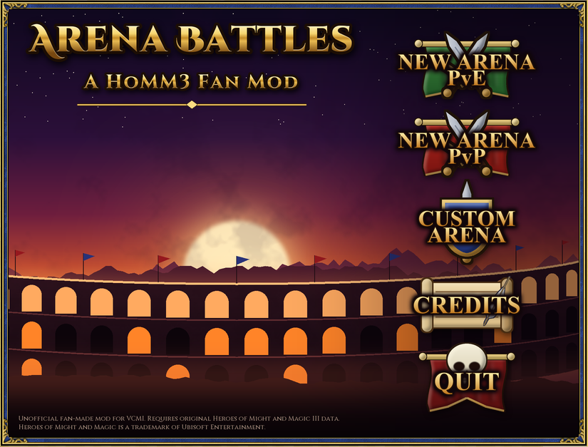
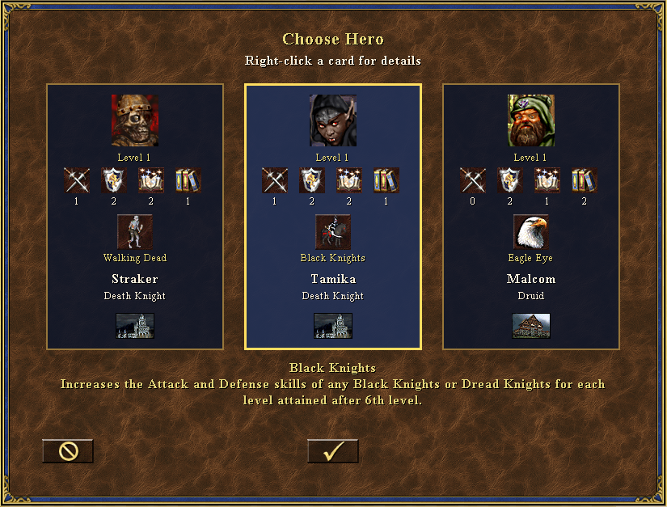
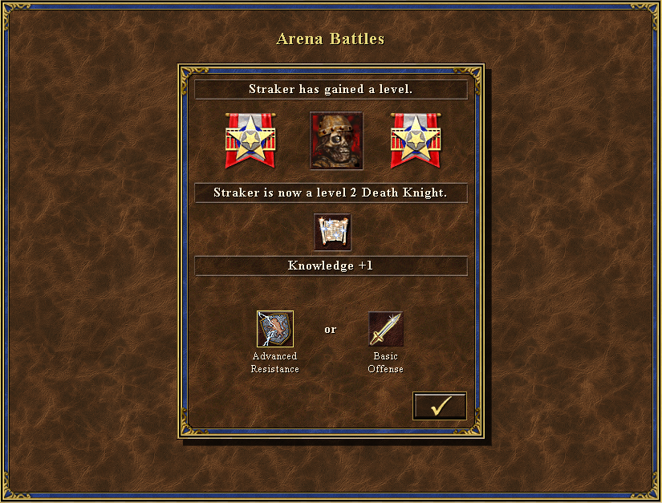
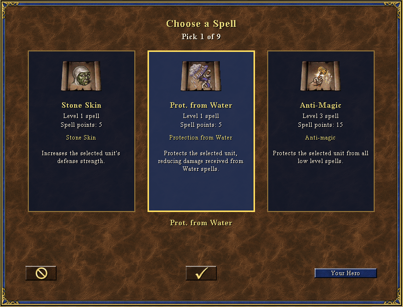
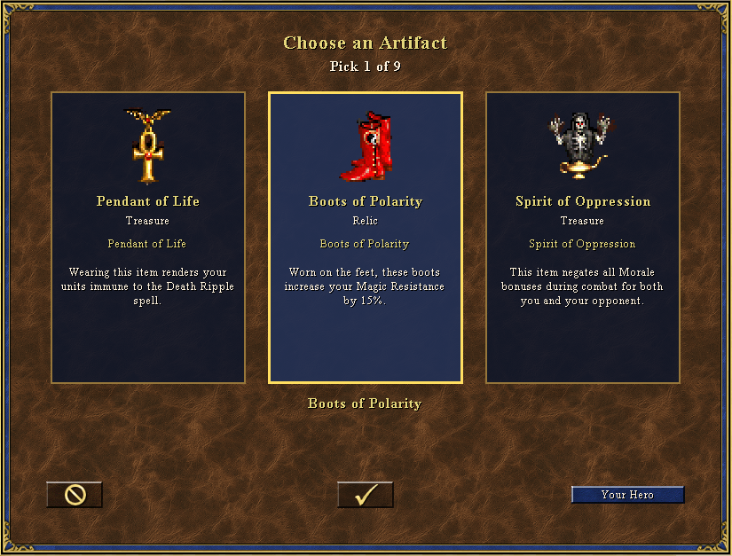
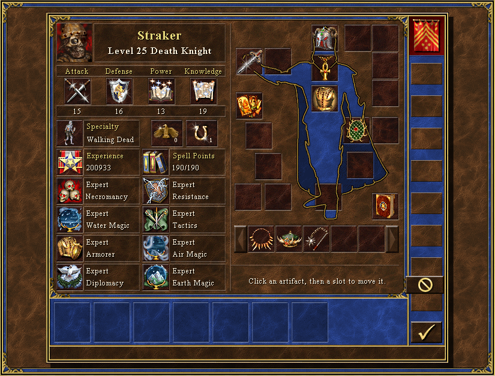
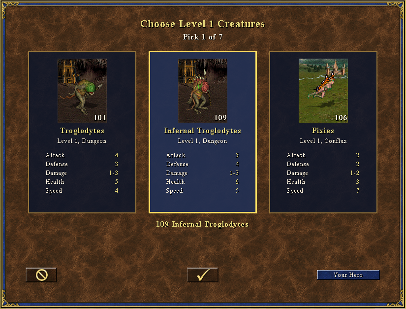
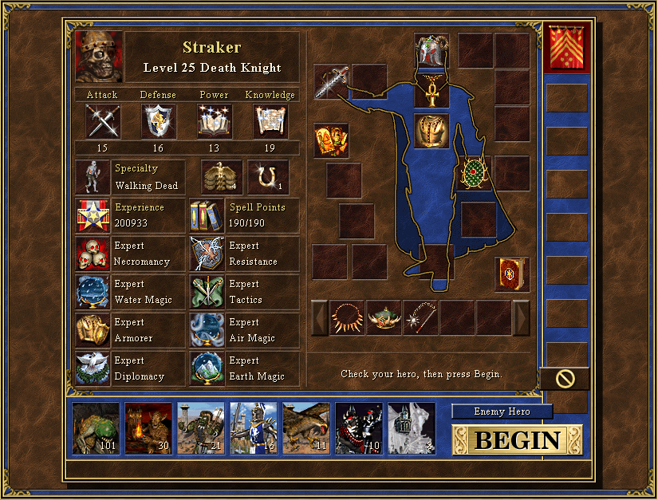
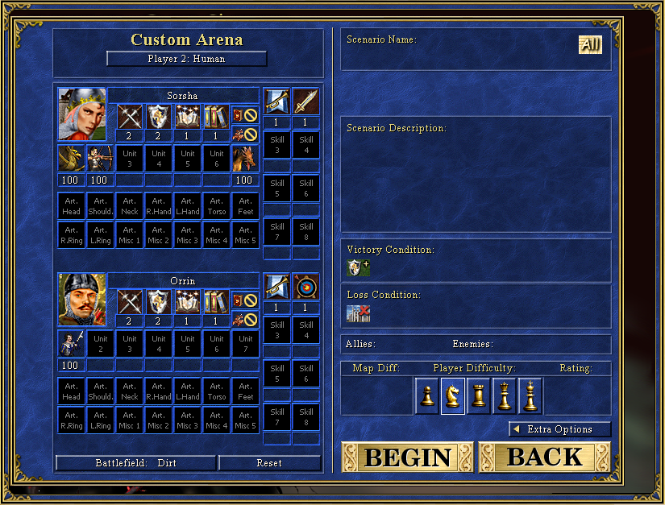
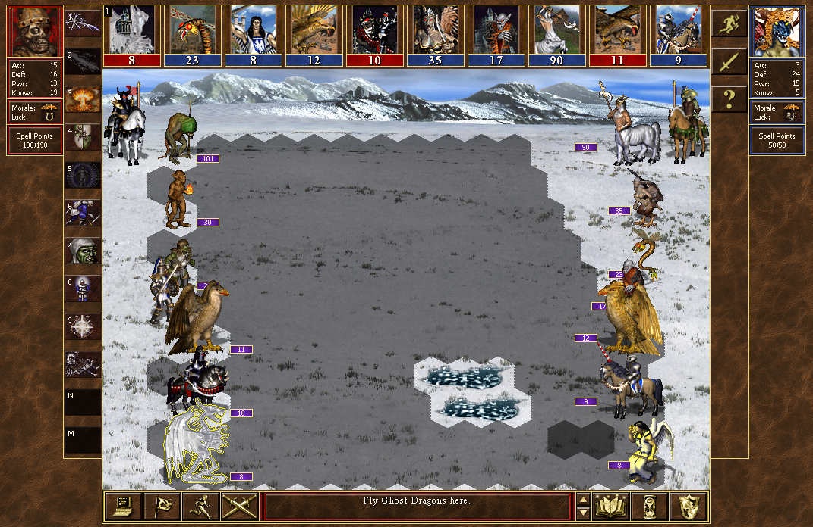

# Arena Battles: A HoMM3 Fan Mod

**Draft a hero, build an army, fight one battle.** Arena Battles is a fan-made arena mode for *Heroes of Might and Magic III*, built on the open-source [VCMI](https://vcmi.eu/) engine. There is no map and no economy, and you won't wait 100 turns. You pick a hero, draft skills, spells, artifacts and creatures one screen at a time, and then everything comes down to one battle.

> **Made by [Tihomir Ivanov](#about-the-author) – [TishGamer on YouTube](https://www.youtube.com/@TishGamer).**
> If you like the mod, **[subscribe to the channel](https://www.youtube.com/@TishGamer?sub_confirmation=1)**. It's the best way to support the work.



---

## Contents

- [Features](#features)
- [Game modes](#game-modes)
- [How a draft works](#how-a-draft-works)
- [Screenshots](#screenshots)
- [Installation](#installation)
  - [Before you start: the original game data](#1-before-you-start-the-original-game-data)
  - [Download](#2-download)
  - [Windows](#windows)
  - [macOS](#macos)
  - [Linux](#linux)
  - [Android](#android)
  - [iOS / iPadOS](#ios--ipados)
  - [First launch](#3-first-launch)
  - [Updating and uninstalling](#4-updating-and-uninstalling)
  - [Troubleshooting](#troubleshooting)
- [Building from source](#building-from-source)
- [Repository layout](#repository-layout)
- [About the author](#about-the-author)
- [Support my work](#support-my-work)
- [Credits and license](#credits-and-license)

---

## Features

- **Three arena modes:**
  - **PvE** draft against the computer;
  - **PvP** hotseat for two players on one computer;
  - **Custom Arena**, where you set up both sides by hand.
- **A full draft in about 10 minutes.** Pick 1 of 3 heroes, level them to 25, then choose 9 spells, 9 artifacts and 7 creature stacks, always from 3 random offers.
- **A smart AI opponent.** In PvE, the computer drafts the same way you do and always takes the strongest offer.
- **Fair fights.** Quick combat is off, both sides get the same number of picks, and the battlefield is random.
- **Original HoMM3 look and feel.** The mod runs on your own copy of the game data, so it has the classic creatures, spells, artifacts, music and battle screen.
- **Runs everywhere VCMI runs:** Windows, macOS, Linux, Android and iOS.
- **Free and open source.**

## Game modes

| Menu item | What it is |
|---|---|
| **New Arena PvE** | You draft a hero and army. The computer drafts its own, then you fight it. |
| **New Arena PvP** | Two players take turns drafting on the same computer (Player 1, then Player 2). Then they fight each other in hotseat. |
| **Custom Arena** | A sandbox. Pick both heroes, their skills, artifacts and **any creatures in any amounts**. Player 2 can be a **Human** or the **Computer**. It is good for testing formations, "creature vs creature" match-ups and theory-crafting. |
| **Credits** | Who made this, and the engine and game credits. |

## How a draft works

1. **Choose your hero.** You get 1 of 3 random heroes. Every hero starts with a spell book.
2. **Level up to 25.** At each level-up you choose a primary skill bonus and a secondary skill, like in the original game.
3. **Spells.** There are 9 screens, and on each you take 1 of 3 spells.
4. **Artifacts.** There are 9 screens, and on each you take 1 of 3 artifacts. Then you **arrange** them on your hero's paper doll.
5. **Creatures.** There are 7 screens, one for each creature level, and on each you take 1 of 3 stacks. Stack sizes depend on the level:

   | Level | 1 | 2 | 3 | 4 | 5 | 6 | 7 |
   |---|---|---|---|---|---|---|---|
   | Amount | 90-110 | 30-40 | 20-25 | 14-18 | 11-13 | 9-10 | 7-8 |

6. **Confirm.** Review your hero and see your opponent's hero. Then press **Begin**.
7. **Fight!** One battle on a random battlefield decides the winner, and then the game ends.

## Screenshots

| | |
|---|---|
|  **Choose 1 of 3 heroes** |  **Level up to 25** |
|  **Draft spells** |  **Draft artifacts** |
|  **Arrange your artifacts** |  **Draft creatures** |
|  **Confirm and begin** |  **Custom Arena sandbox** |



---

## Installation

Arena Battles is a **standalone app**. It ships as its own build of the VCMI engine, with the mod built in and turned on automatically. You don't need to copy the mod anywhere or enable it in a launcher.

### 1. Before you start: the original game data

> **Arena Battles does not include any Heroes of Might and Magic III files. You need your own legal copy of the game.**

Any of these works:

- *Heroes of Might and Magic III: Complete* (for example from [GOG](https://www.gog.com/game/heroes_of_might_and_magic_3_complete_edition));
- *Shadow of Death*;
- the original CD version with both expansions.

The **HD Edition** (Steam) is **not** enough on its own. VCMI needs the files from *Complete* or *SoD*.

Arena Battles uses the same game data as VCMI. **If you already play VCMI on a computer, Arena Battles will find your data automatically.**

### 2. Download

Go to **[Releases](https://github.com/tishonator/arena-battles-hmm3-fan-mod/releases)** and download the file for your system:

| System | File | Notes |
|---|---|---|
| Windows 10/11 (64-bit) | `ArenaBattles-<version>-windows-x64.exe` (installer) or `.zip` (portable) | Also built for x86 and ARM64 |
| macOS (Apple Silicon) | `ArenaBattles-<version>-macos-arm.dmg` | |
| macOS (Intel) | `ArenaBattles-<version>-macos-intel.dmg` | |
| Linux (x86-64) | `ArenaBattles-<version>.AppImage` | Works on most distributions |
| Android 5.0+ | `ArenaBattles-<version>.apk` | |
| iOS / iPadOS | `ArenaBattles-<version>.ipa` | Needs sideloading, see below |

> The exact file names may differ a little. If you want to try the newest development build, open the **[Actions](https://github.com/tishonator/arena-battles-hmm3-fan-mod/actions)** tab and pick the latest green run of the `arena-battles` branch. Its **Artifacts** section has the same packages. You need to be signed in to GitHub to download them.

### Windows

1. Run the `.exe` installer. Windows SmartScreen may warn you because the installer is not code-signed. Click **More info → Run anyway**.
   - If you prefer the portable `.zip`, extract it to any folder, for example `C:\Games\ArenaBattles`.
2. The installer adds a **VCMI Arena Battles** shortcut. It installs **next to** any official VCMI install and does not replace it.
3. Start **VCMI Arena Battles** (`VCMI_launcher.exe` in the portable version) and continue with [First launch](#3-first-launch).

### macOS

1. Open the `.dmg` and drag **VCMI** (Arena Battles) into **Applications**. To keep an official VCMI install as well, rename the app first, for example to *Arena Battles*.
2. The app is not notarized by Apple. The first time you open it, **right-click → Open**, then confirm.
   - If macOS says the app is "damaged", run this in Terminal: `xattr -cr "/Applications/<app name>.app"`
3. Continue with [First launch](#3-first-launch).

### Linux

1. Make the AppImage executable and run it:
   ```sh
   chmod +x ArenaBattles-*.AppImage
   ./ArenaBattles-*.AppImage
   ```
2. On some distributions you also need FUSE 2 (`sudo apt install libfuse2` on Ubuntu/Debian).
3. Continue with [First launch](#3-first-launch).

### Android

1. Download the `.apk` on your phone or tablet and open it. Allow installing from this source when Android asks (*Settings → Install unknown apps*).
2. The app is called **Arena Battles**. It installs as a **separate app** next to the official VCMI app.
3. On first start, the launcher asks for your HoMM3 data. Copy the `Data`, `Maps` and `Mp3` folders from your PC install to the device, then point the launcher at them. You can also import the GOG offline installer directly.

### iOS / iPadOS

iOS only allows App Store apps unless you sideload them, so:

1. Install a sideloading tool such as [AltStore](https://altstore.io/) or [Sideloadly](https://sideloadly.io/) on your computer.
2. Sideload the `.ipa` with your Apple ID. With a free Apple ID you must refresh the app every 7 days.
3. Copy the `Data`, `Maps` and `Mp3` folders from your PC install into the app's folder using the **Files** app (or Finder/iTunes file sharing). Then start the app.

### 3. First launch

1. The **launcher** opens first. If it doesn't find your HoMM3 data, its setup wizard asks for it. You have two options:
   - point it at your HoMM3 install folder (the one containing `Data`, `Maps` and `Mp3`);
   - give it the **GOG offline installer** (`setup_heroes_of_might_and_magic_3_complete_*.exe`), and it unpacks the files for you.
2. Skip the wizard's mod suggestions if you like. **Arena Battles is already built in and enabled.**
3. Press **Start game**. The **Arena Battles** main menu opens.
4. Choose **New Arena PvE** and have fun!

For more help with the game data, see the official VCMI guides. Arena Battles uses the same steps:
[Windows](https://vcmi.eu/players/Installation_Windows/) ·
[macOS](https://vcmi.eu/players/Installation_macOS/) ·
[Linux](https://vcmi.eu/players/Installation_Linux/) ·
[Android](https://vcmi.eu/players/Installation_Android/) ·
[iOS](https://vcmi.eu/players/Installation_iOS/)

### 4. Updating and uninstalling

- **Updating:** download the new release and install it over the old one, or extract the new `.zip` or AppImage instead. Your settings and game data stay where they are.
- **Uninstalling:**
  - Windows: *Settings → Apps → VCMI Arena Battles → Uninstall*;
  - macOS: delete the app;
  - Linux: delete the AppImage;
  - Android and iOS: remove the app.

  The HoMM3 data and settings live in the VCMI user folder (for example `Documents\My Games\vcmi` on Windows). Leave that folder if you also use VCMI.

### Troubleshooting

| Problem | Fix |
|---|---|
| "Heroes III data files are missing" | The launcher can't find `Data`, `Maps` and `Mp3`. Run the launcher's setup wizard again (*Settings → Run setup wizard*) and point it at a *Complete* or *SoD* install. |
| The normal VCMI menu appears instead of Arena Battles | You started the official VCMI, not Arena Battles. Use the **VCMI Arena Battles** shortcut. |
| The game starts in a small window | Change the resolution and fullscreen settings in the launcher (*Settings*) or in-game (*Esc → System options*). |
| Something else went wrong | Open an [issue](https://github.com/tishonator/arena-battles-hmm3-fan-mod/issues) and attach `VCMI_Client_log.txt` from the `logs` folder inside the VCMI user folder. |

---

## Building from source

This repository is a fork of [VCMI](https://github.com/vcmi/vcmi), based on the **1.7.5** release. You build Arena Battles the same way you build VCMI. Follow the official guides:
[Windows](https://vcmi.eu/developers/Building_Windows/) ·
[macOS](https://vcmi.eu/developers/Building_macOS/) ·
[Linux](https://vcmi.eu/developers/Building_Linux/) ·
[Android](https://vcmi.eu/developers/Building_Android/) ·
[iOS](https://vcmi.eu/developers/Building_iOS/)

The `Mods/arenabattles` folder is installed with the engine automatically. On desktop it is copied next to the executables, and on Android and iOS it is bundled into the app.

**Automatic builds (GitHub Actions)**

- Every push to the `arena-battles` branch builds packages for **all platforms**: Windows x64/x86/ARM64, macOS Intel/ARM, Linux AppImage, Android and iOS. They appear under the run's **Artifacts**.
- **Making a release:** push a version tag, and CI builds everything and creates a **draft release** with all the packages attached. Check it and press *Publish*.
  ```sh
  git tag v0.5.0
  git push origin v0.5.0
  ```
- Code signing is optional:
  - macOS and Windows signing are skipped when the secrets aren't set;
  - Android uses the public development keystore that VCMI ships for daily builds;
  - the iOS `.ipa` is unsigned and is meant for sideloading.

**The button art**

The menu buttons are original art, drawn by a script. They don't contain any pixels from the original game. To regenerate them (needs Python 3 and Pillow):

```sh
pip install pillow
python arena-battles/tools/build_buttons.py   # main menu buttons
python arena-battles/tools/build_assets.py    # title, background, icon
python arena-battles/tools/preview.py         # optional: renders a menu preview image
```

## Repository layout

| Path | What's inside |
|---|---|
| `Mods/arenabattles/` | **The mod:** `mod.json`, main menu layout, texts (`Content/config/arenabattles/english.json`) and graphics |
| `client/arena/` | The draft screens and logic (hero, level-up, spell, artifact and creature picks; AI drafting) |
| `client/mainmenu/`, `client/lobby/`, … | Small engine hooks: menu commands, PvP hotseat, Custom Arena, credits |
| `lib/modding/ModManager.cpp` | Keeps the Arena Battles mod enabled in this build |
| `arena-battles/tools/` | Scripts that generate the mod's graphics, plus fonts (SIL Open Font License) |
| `arena-battles/screenshots/` | The images used in this README |
| `CI/`, `.github/workflows/` | Build and release pipeline for all platforms |
| everything else | The VCMI engine (see `AUTHORS.h`, `ChangeLog.md`) |

---

## About the author

Hi! I'm **Tihomir Ivanov**, a software developer and a lifelong *Heroes of Might and Magic* fan. I make gaming videos on my YouTube channel **[TishGamer](https://www.youtube.com/@TishGamer)**. I also build free, open-source projects that I share on GitHub as **[tishonator](https://github.com/tishonator)**, such as [TishCommerce](https://github.com/tishonator/TishCommerce), a free self-hosted eCommerce platform.

Arena Battles started from a simple wish. I wanted the best part of HoMM3 (the big hero-vs-hero battle) without having to play a whole map to get there. I hope you enjoy it as much as I enjoyed making it.

- **YouTube:** [youtube.com/@TishGamer](https://www.youtube.com/@TishGamer)
- **GitHub:** [github.com/tishonator](https://github.com/tishonator)
- **This mod:** [github.com/tishonator/arena-battles-hmm3-fan-mod](https://github.com/tishonator/arena-battles-hmm3-fan-mod)

## Support my work

Arena Battles is **free**, and it will stay free. Making and maintaining it takes a lot of time. If you enjoy it, here is how you can help:

1. **[Subscribe to TishGamer on YouTube](https://www.youtube.com/@TishGamer?sub_confirmation=1)** and turn on the 🔔. It's free, and it's the most solid way to support my work. Every subscriber, like and comment helps the channel grow, and that lets me keep making mods and videos.
2. **Share the mod.** Send it to a friend, challenge them to a PvP duel, or post it on your favourite HoMM3 forum or Discord.
3. **Star this repository** ⭐ on GitHub so more players can find it.
4. **Report bugs and ideas** in [Issues](https://github.com/tishonator/arena-battles-hmm3-fan-mod/issues).
5. **Donate.** If you'd like to buy me a coffee, any amount is greatly appreciated:

   [](https://www.paypal.com/donate/?hosted_button_id=S88TKD55YVK7S)

Your support helps me keep this project alive and improve it further. Thank you! ❤

---

## Credits and license

- **Mod design, code and art:** Tihomir Ivanov ([TishGamer](https://www.youtube.com/@TishGamer)).
- **Engine:** [VCMI](https://vcmi.eu/) by the VCMI Team and contributors, licensed under the **GNU GPL v2 or later**. This fork, including all Arena Battles changes, is released under the same license (see `license.txt`). The full source code is in this repository.
- **Fonts:** Cinzel, under the SIL Open Font License (the license is in `arena-battles/tools/fonts/`).
- **Heroes of Might and Magic** is a trademark of Ubisoft Entertainment. This is an **unofficial, non-commercial fan project**, and it is not made, endorsed or supported by Ubisoft or the VCMI Team. It doesn't include or distribute any of the original game's files. You need your own copy of the game.
